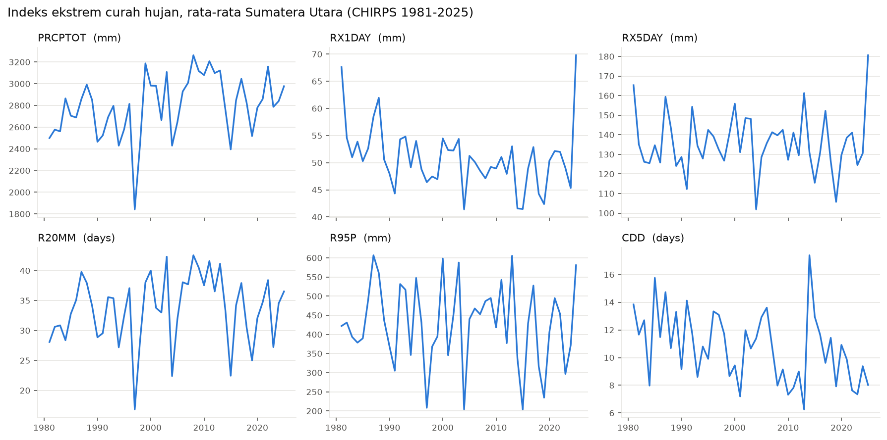

# Extreme Rainfall in North Sumatra: Trend vs. ENSO/IOD Modulation

> Decomposing long-term trends and climate-mode modulation of extreme rainfall in North Sumatra, Indonesia, using Circulant Singular Spectrum Analysis (CiSSA) and non-stationary extreme value analysis.

**Status:** 🚧 Work in progress. Done: data pipeline (Week 1), extreme indices (Week 2), SQL analysis (Week 3). Next: CiSSA decomposition and trend tests.

## Why this matters

Extreme rainfall drives floods and landslides across North Sumatra, affecting cities such as Medan, agriculture, and infrastructure. Part of its variability comes from long-term change, and part from natural climate modes, mainly **ENSO** (Pacific) and the **Indian Ocean Dipole** (Indian Ocean). Separating the two matters for planning: a "trend" estimated over a period dominated by La Niña years can overstate future risk, and vice versa.

This project asks:

1. How much of the variability in rainfall extremes comes from long-term trends versus ENSO/IOD modulation?
2. Does a non-stationary GEV model with CiSSA-derived climate-mode covariates outperform a stationary GEV?
3. How do 10-, 25- and 50-year return levels differ between El Niño, neutral and La Niña phases?

## First results



Province-wide averages from CHIRPS, 1981–2025 (2,289 grid cells inside North Sumatra):

- **Driest year: 1997** (1,842 mm), during a strong El Niño combined with a positive Indian Ocean Dipole.
- **Wettest year: 2008** (3,263 mm), during La Niña.
- **2025 set the record** for maximum 1-day (70 mm, province average) and 5-day (181 mm) rainfall, consistent with the floods and landslides caused by Tropical Cyclone Senyar in late November 2025.

SQL analysis of these indices (trends by regency, ENSO-phase comparisons, 2025 anomalies) is in [`outputs/tables/RESULTS.md`](outputs/tables/RESULTS.md).

## Data

| Dataset | Description | Source |
|---|---|---|
| CHIRPS v2.0 | Daily rainfall, 0.05°, 1981–2025 | UCSB Climate Hazards Center |
| ONI | Oceanic Niño Index (ENSO) | NOAA CPC |
| Niño 3.4 | Monthly SST anomaly | NOAA PSL |
| DMI | Dipole Mode Index (IOD) | NOAA PSL |
| Admin boundaries | Province (ADM1) and 33 regencies (ADM2) | geoBoundaries (OSM; BPS/OCHA) |
| BMKG stations | Gauge data for validation | BMKG *(planned)* |

Raw data are not stored in this repository. Every dataset is downloaded with a script.

**Known limitation:** the current CHIRPS download box starts at 0.5°N, so about 2.3% of the province (the Batu Islands in South Nias and the southern tip of Mandailing Natal) is not yet covered. These regencies are flagged in all outputs.

## Methods

- ✅ ETCCDI extreme indices: PRCPTOT, RX1DAY, RX5DAY, R20MM, R95P (1991–2020 base), CDD
- ✅ Province and regency aggregation with administrative masks
- ✅ SQL analysis in DuckDB (CTEs, window functions, joins with climate indices)
- ⏳ CiSSA decomposition into trend and ENSO/IOD-band oscillatory components
- ⏳ Mann–Kendall trend test and Sen's slope on the trend component
- ⏳ Stationary vs. non-stationary GEV (covariates from CiSSA components)
- ⏳ Climate-phase return levels, mapped in an interactive dashboard

## Reproduce

```bash
conda env create -f environment.yml
conda activate sumut-rain

python scripts/download_chirps.py --source chc   # CHIRPS 1981-2025 (resumable)
python scripts/download_climate_indices.py      # ONI, Nino 3.4, DMI
python scripts/check_data.py                    # quality checks + map

python tests/test_indices.py                    # unit tests for the index formulas
python scripts/download_boundaries.py           # province + 33 regencies
python scripts/compute_indices.py               # ETCCDI indices

python scripts/build_database.py                # DuckDB database
python scripts/run_queries.py                   # SQL analysis -> outputs/tables/
```

Region, period, and index settings are in [`config.yaml`](config.yaml).

## Project structure

```
├── config.yaml          # region, period, data sources, index settings
├── environment.yml      # conda environment
├── scripts/             # download, processing, database and query scripts
├── src/sumut_rain/      # reusable code (ETCCDI index functions)
├── sql/                 # SQL queries
├── tests/               # unit tests
├── notebooks/           # analysis notebooks
├── data/                # raw / processed / external (git-ignored)
├── outputs/             # figures and query results
└── paper/               # manuscript materials
```

## Author

**Sisti Nadia Amalia** — Lecturer, Department of Statistics, Universitas Negeri Medan.
Research: singular spectrum analysis for climate time series, spatial clustering, climate risk zoning.

## License

Code: MIT. Data remain under their original providers' terms.
